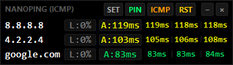
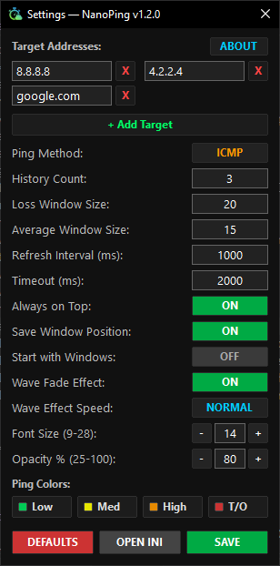

# NanoPing

[](https://github.com/NetForgeDev/NanoPing/actions/workflows/release.yml)
[](https://github.com/NetForgeDev/NanoPing/releases/latest)
[](https://github.com/NetForgeDev/NanoPing/releases)
[](LICENSE)

An ultra-lightweight, portable, native Windows live ping monitor written in **Rust & Win32 API**.  
Engineered for minimal resource footprint (**~1.8 MB RAM**, **< 1 MB standalone `.exe`**) with zero external runtime dependencies.

## Screenshots

<table align="center">
  <tr>
    <td align="center" valign="middle">
      
      <br />
      <sub><b>Live Monitor HUD</b></sub>
    </td>
    <td align="center" valign="middle">
      
      <br />
      <sub><b>Settings Dialog</b></sub>
    </td>
  </tr>
</table>

## Features

- **Ultra-Low Resource Usage:** Pure native Rust + Double-Buffered Win32 GDI (~1.8 MB RAM, near-zero idle CPU).
- **100% Portable:** Single standalone `NanoPing.exe` that automatically manages a local `config.ini` beside itself.
- **3 Ping Methods:**
  - **ICMP:** Uses native Windows `IcmpSendEcho` API — **no Administrator privileges required**.
  - **TCP:** Measures TCP handshake latency on port `443`.
  - **UDP:** Multi-protocol probe (DNS `53`, RFC 9000 QUIC `443`, STUN `3478`, and Port Unreachable `33434`).
- **Real-Time Statistics:** Sliding-window packet loss (`L:0%`), rolling average (`A:42ms`), and live taskbar title updates.
- **Customizable Dark HUD:**
  - Borderless pure-black HUD with Windows 11 rounded corners, minimal `−` / `×` header controls, full-window drag, and ClearType rendering.
  - Unified proportional font scaling (`9`–`28`) and customizable latency colors (`Low`, `Med`, `High`, `T/O`).
  - Smooth 60 FPS wave fade animations with 4 speed profiles.
- **Live Preview Settings:** Changes inside Settings preview immediately on the main window and cleanly revert if closed without saving.
- **Smart Multi-Monitor Persistence:** Saves window coordinates immediately after moving and automatically recovers onto a connected display if a monitor is disconnected.
- **Automatic Self-Updater:** Silently checks GitHub Releases on launch, displays a compact `UPD` badge when a new version is available, and performs a clean one-click in-place update without touching `config.ini`.
- **Dark Floating Tooltips:** Native dark-themed hover tooltips for all compact header buttons (`UPD`, `SET`, `PIN`, `ICMP/TCP/UDP`, `RST`).

## Download

Grab the latest standalone `NanoPing.exe` or portable `.zip` archive from the [Releases](https://github.com/NetForgeDev/NanoPing/releases/latest) page.

> **Windows SmartScreen Notice:** Because `NanoPing.exe` is an unsigned open-source binary, Windows Defender SmartScreen may display *"Windows protected your PC"* on the first launch after downloading from a browser. Click **More info** → **Run anyway** to run it. All release binaries and `SHA256SUMS.txt` checksums are built transparently from source via [GitHub Actions](.github/workflows/release.yml).

To verify your downloaded binary in PowerShell:
```powershell
Get-FileHash NanoPing.exe -Algorithm SHA256
```

## Configuration (`config.ini`)

`config.ini` is automatically created beside `NanoPing.exe` on first launch:

| Key | Description | Default |
| :--- | :--- | :--- |
| `targets` | Comma-separated IP addresses or hostnames | `8.8.8.8, 4.2.2.4, google.com` |
| `ping_method` | `icmp`, `tcp`, or `udp` | `icmp` |
| `history_count` | Number of recent samples shown (`1`–`20`) | `3` |
| `loss_window_size` | Sliding sample window for packet loss % | `20` |
| `avg_window_size` | Sliding sample window for rolling average | `15` |
| `refresh_interval_ms` | Delay between probes in milliseconds | `1000` |
| `timeout_ms` | Timeout threshold in milliseconds | `2000` |
| `always_on_top` | Keep window pinned above other windows | `True` |
| `save_position` | Save window position immediately when moved | `True` |
| `autostart` | Launch automatically with Windows | `False` |
| `wave_effect` | Enable wave fade animation on updates | `True` |
| `wave_speed` | `normal`, `slow`, `fast`, or `very fast` | `normal` |
| `font_size` | Unified proportional UI font size (`9`–`28`) | `14` |
| `opacity` | Main window opacity percentage (`25`–`100`) | `100` |
| `check_updates` | Silently check for GitHub updates on startup | `True` |
| `color_low` | Hex color for latency `< 100ms` | `#00cc55` |
| `color_medium` | Hex color for latency `100–200ms` | `#e6e600` |
| `color_high` | Hex color for latency `> 200ms` | `#e68a00` |
| `color_timeout` | Hex color for timeouts / high packet loss | `#cc3333` |

## Building from Source

### Prerequisites
- [Rust](https://rustup.rs/) (`x86_64-pc-windows-msvc` toolchain)

### Commands
```bash
# Development run
cargo run

# Optimized standalone release binary
cargo build --release
```
The compiled executable is generated at `target/release/NanoPing.exe`.

## License

This project is licensed under the [MIT License](LICENSE).
